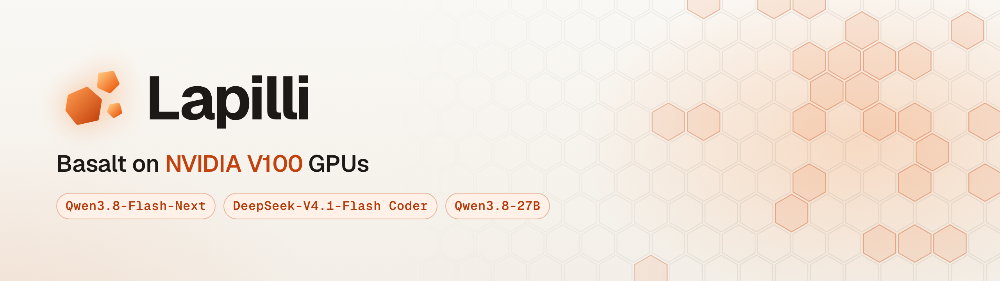
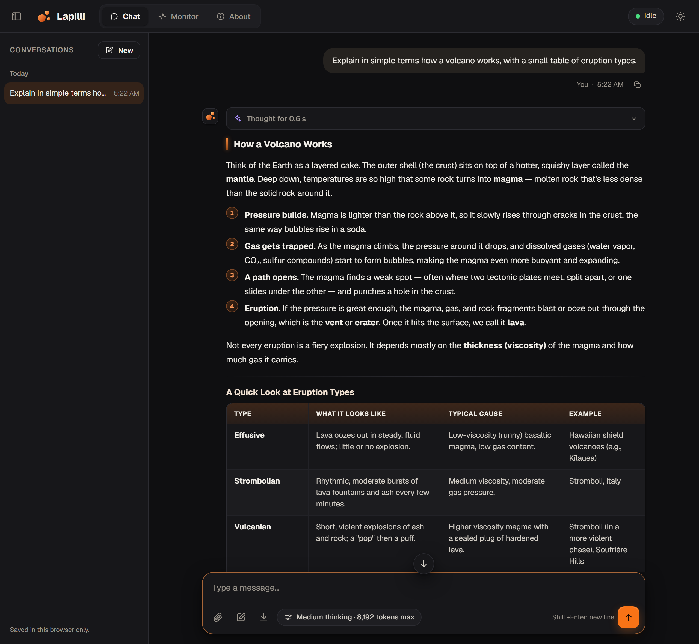
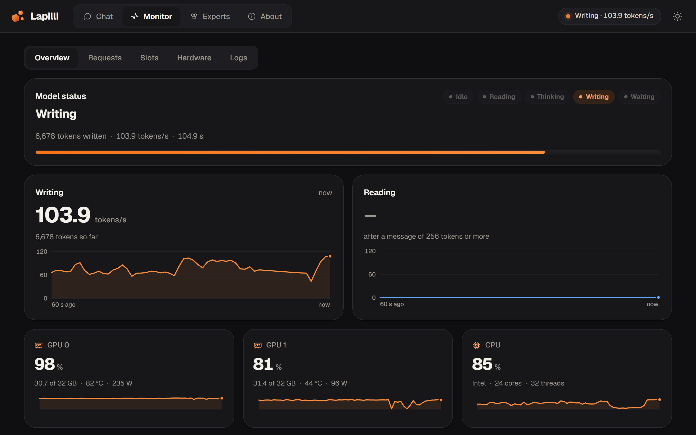
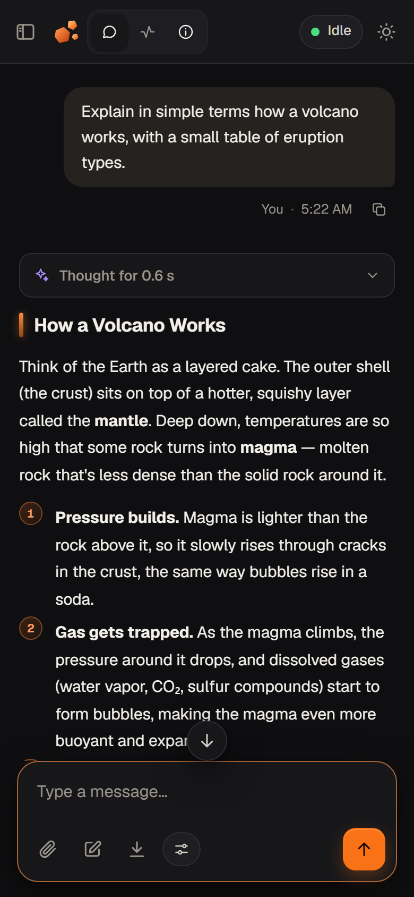
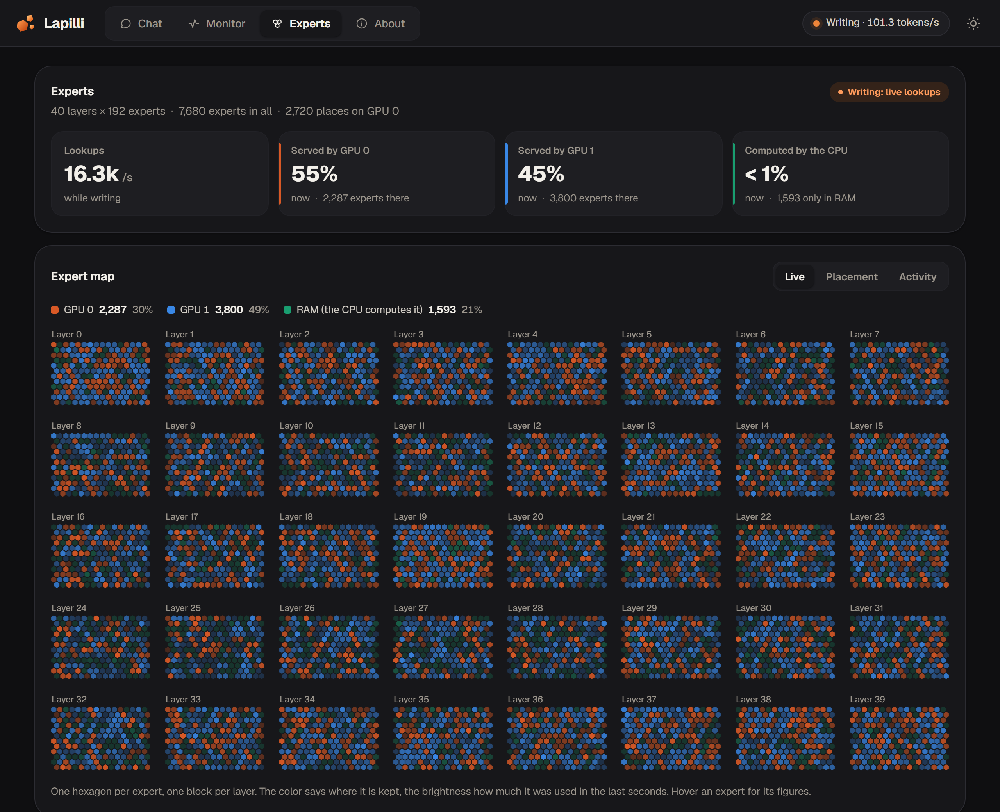

<p align="center">
  <picture>
    <source media="(prefers-color-scheme: dark)" srcset="docs/img/lapilli-banner-dark.png">
    
  </picture>
</p>

<p align="center">
  <a href="https://github.com/chris83-dev/lapilli-v100/releases"></a>
  
  
  
  <a href="LICENSE"></a>
</p>

<p align="center">
  <b>Votre V100 n'a pas dit son dernier mot.</b><br>
  Un portage de <a href="https://github.com/jesdga95/basalt">Basalt</a> pour Volta (compute capability 7.0), avec une page de discussion et un moniteur en direct.
</p>

<p align="center">
  <a href="#les-trois-modèles">Modèles</a> ·
  <a href="#modèles-recommandés">Téléchargements</a> ·
  <a href="#nouveautés-de-la-v05">Nouveautés</a> ·
  <a href="#essayé-par-la-communauté">Communauté</a> ·
  <a href="#démarrage-rapide-windows">Démarrage rapide</a> ·
  <a href="#compiler">Compiler</a> ·
  <a href="README.md">English</a>
</p>

Basalt ne vise que Blackwell (sm_120). Lapilli ajoute sm_70 et garde la compilation Blackwell telle quelle. Un seul
`basalt.exe` fait tourner les trois modèles de Basalt sur des cartes V100 ; le serveur garde les API OpenAI et Anthropic de
Basalt et sert la page de discussion de Lapilli à `/` (le tableau de bord de Basalt passe à `/dashboard`).

*Les lapilli sont les petits fragments que projette un volcan : de petits morceaux de basalte.*

<p align="center"></p>
<p align="center">&nbsp;&nbsp;</p>
<p align="center"></p>
<p align="center"><sub>La page de discussion et la même page sur un téléphone, avec le Qwen3.8-27B sur une V100 ; le Moniteur pendant l'écriture
d'une réponse et l'onglet Experts avec ses 7 680 experts, avec le DeepSeek Coder sur deux. Captures de cette version. La page
est en anglais.</sub></p>

> Fondé sur le commit `6809edfa` de Basalt (15 novembre 2026), avec quelques morceaux plus récents de Basalt (la console de la
> carte des experts, MIT). Fourni tel quel, sans assistance (voir [Assistance](#assistance)).

## Les trois modèles

| | Cartes | Paquet | Vitesse d'écriture | Lecture du message | Justesse contre le BF16 |
|---|---|---|---|---|---|
| **Qwen3.8-27B**<br><sub>dense, NVFP4</sub> | **1 × V100** | 21 Go, le paquet officiel | **88** jetons/s avec son brouillon sur une conversation, 186 sur une sortie structurée | 697 jetons/s à 16K, 637 à 32K | KLD 0,02297, même 1er choix 93,37 % |
| **DeepSeek-V4.1-Flash Coder**<br><sub>192 experts, IQ2_XXS</sub> | 2 × V100 | 192 Go, converti (voir plus bas) | **98** jetons/s sur du code, 64 sur du texte, avec son brouillon DSpark | | pas de référence BF16 pour ce paquet |
| **Qwen3.8-Flash-Next**<br><sub>mélange d'experts</sub> | 2 × V100 | 115 Go, `UD-Q4_K_XL` | **139** jetons/s sur une longue réponse avec réflexion, 91 sur une courte | 1 172 jetons/s à 4K, 1 446 à 16K | KLD 0,04932, même 1er choix 92,75 % |

Mesuré sur une seule machine : 2 × V100-SXM2 32 Go (sur des liens PCIe 3.0 x16 et x4, pair à pair coupé : voir plus bas),
Intel Core i9-14900K, 96 Go de mémoire, Windows 10, CUDA 12.6, pilote NVIDIA 561.17, les paquets sur un SSD NVMe. Mesuré le
23 novembre 2026, avec la version de ce dépôt. Les vitesses mesurées par le serveur sont la médiane de trois passages ; celles
de `basalt-bench` (le 27B) sont sa moyenne de trois passages. La justesse est la porte de
Basalt (`basalt-bench --quality 100` : 100 morceaux par le chemin de décodage, contre la référence BF16).

## Modèles recommandés

Les paquets avec lesquels tous les chiffres ci-dessus ont été mesurés, et où les télécharger. Chaque paquet a sa propre
licence, sur sa page Hugging Face.

### Qwen3.8-27B, sur une seule V100

Un modèle dense de 27 milliards de paramètres : 64 couches (48 Gated DeltaNet, 16 d'attention à porte), réflexion et outils,
un contexte jusqu'à 262 144 jetons, et un brouillon par blocs DFlash 2 dans le paquet, qui écrit plusieurs jetons à la fois.

- **Paquet** : `Qwen3.8-27B-QUASAR-NVFP4.basalt`, 21,1 Go : le paquet officiel de Basalt (poids NVFP4, depuis le checkpoint de QUASAR)
- **Téléchargement** : [jesdga/Qwen3.8-27B-Basalt](https://huggingface.co/jesdga/Qwen3.8-27B-Basalt) · [lien direct](https://huggingface.co/jesdga/Qwen3.8-27B-Basalt/resolve/main/Qwen3.8-27B-QUASAR-NVFP4.basalt)
- **Il faut** : une V100 de 32 Go

```bat
hf download jesdga/Qwen3.8-27B-Basalt Qwen3.8-27B-QUASAR-NVFP4.basalt --local-dir models
bin\basalt.exe serve models\Qwen3.8-27B-QUASAR-NVFP4.basalt --gpu 0 --kv int8 --max-context 262144 --port 8080
```

### DeepSeek-V4.1-Flash Coder, sur deux V100

DeepSeek-V4.1-Flash est un mélange d'experts : 40 couches de 384 experts, 6 choisis pour chaque jeton plus un expert partagé.
Le Coder GSQ-RCO d'ISTA-DASLab est une version pour le code qui garde 192 des 384 experts de chaque couche, en IQ2_XXS ; le
brouillon DSpark d'Unsloth écrit plusieurs jetons à la fois. Il n'existe pas de paquet Basalt tout fait : on le fabrique à
partir des fichiers GGUF (environ 184 Go à télécharger, 192 Go une fois fabriqué).

- **Modèle** : [ISTA-DASLab/DeepSeek-V4.1-Flash-1017-GSQ-RCO-Coder-GGUF](https://huggingface.co/ISTA-DASLab/DeepSeek-V4.1-Flash-1017-GSQ-RCO-Coder-GGUF) (révision `54229d38`) : les cinq morceaux de `IQ2_XXS/` (72,1 Go), la table Engram `DeepSeek-V4.1-Flash-Engram-IQ4_NL.gguf` (110,6 Go) et `mmproj-DeepSeek-V4.1-Flash-1017-BF16.gguf` (1,0 Go)
- **Brouillon** : [unsloth/DeepSeek-V4.1-Flash-1017-GGUF](https://huggingface.co/unsloth/DeepSeek-V4.1-Flash-1017-GGUF) (révision `dfcee0ec`) : `dspark-DeepSeek-V4.1-Flash-1017-Q8_0.gguf` (8,0 Go)
- **Il faut** : deux V100 de 32 Go, 96 Go de mémoire dont 20 Go gardés libres (son étage en mémoire est verrouillé), un SSD NVMe rapide

1. Mettre les cinq morceaux `IQ2_XXS`, le fichier `mmproj` et la table Engram dans un même dossier, la table Engram renommée
   en sixième morceau : `DeepSeek-V4.1-Flash-1017-GSQ-RCO-Coder-IQ2_XXS-00006-of-00006.gguf`.
2. Convertir, puis ajouter le brouillon (le convertisseur lit les GGUF projetés en mémoire : une dizaine de minutes depuis un
   SSD NVMe), puis lancer le serveur :

```bat
.venv\Scripts\python tools\convert\convert.py --gguf <dossier>\DeepSeek-V4.1-Flash-1017-GSQ-RCO-Coder-IQ2_XXS-00001-of-00006.gguf --mmproj <dossier>\mmproj-DeepSeek-V4.1-Flash-1017-BF16.gguf --out models\DeepSeek-V4.1-Flash-1017-GSQ-RCO-Coder-IQ2_XXS.basalt
.venv\Scripts\python tools\convert\convert.py --dspark dspark-DeepSeek-V4.1-Flash-1017-Q8_0.gguf --into models\DeepSeek-V4.1-Flash-1017-GSQ-RCO-Coder-IQ2_XXS.basalt --undo-dir models\dspark-undo
bin\basalt.exe serve models\DeepSeek-V4.1-Flash-1017-GSQ-RCO-Coder-IQ2_XXS.basalt --gpu 0,1 --kv fp16 --vram-reserve-mib 700 --ram-reserve-mib 20480 --max-context 32768 --vision off --port 8080
```

Le paquet fini fait 192 059 655 012 octets, en 14 sections. Son classement des experts pour 192 experts, tiré de celui du
modèle de base par `tools/profiles/derive_pruned_profile.py`, est dans `data/profiles/`. Une V100 n'a pas de FP8 : le contexte
est en fp16.

### Qwen3.8-Flash-Next, sur deux V100

Un mélange d'experts : 48 couches (36 Gated DeltaNet, 12 d'attention QSA) de 512 experts, 10 choisis pour chaque jeton, un
brouillon MTP dans le paquet, et la lecture d'images. Les experts qui ne tiennent pas dans les cartes sont lus depuis la
mémoire et depuis le SSD.

- **Paquet** : `Qwen3.8-FN-UD-Q4_K_XL.basalt`, 115 Go (K-quants : les paquets NVFP4 de ce modèle demandent du matériel FP4)
- **Téléchargement** : [jesdga/Qwen3.8-Flash-Next-Basalt](https://huggingface.co/jesdga/Qwen3.8-Flash-Next-Basalt) · [lien direct](https://huggingface.co/jesdga/Qwen3.8-Flash-Next-Basalt/resolve/main/Qwen3.8-FN-UD-Q4_K_XL.basalt)
- **Il faut** : deux V100 de 32 Go, 96 Go de mémoire, un SSD NVMe rapide
- **Plus petit** : `Qwen3.8-FN-UD-IQ3_XXS.basalt` (87,6 Go, même page), lancé par un utilisateur sur une seule V100 de 16 Go : voir [son rapport](docs/community/v100-16gb-linux.md)

```bat
hf download jesdga/Qwen3.8-Flash-Next-Basalt Qwen3.8-FN-UD-Q4_K_XL.basalt --local-dir models
bin\basalt.exe serve models\Qwen3.8-FN-UD-Q4_K_XL.basalt --gpu 0,1 --kv int8 --mmap-experts --resident-experts --peer-exclusive --vram-reserve-mib 700 --ram-reserve-mib 16384 --max-context 262144 --vision dynamic --port 8080
```

## Le détail des mesures

<details>
<summary><b>Qwen3.8-27B sur une seule V100</b></summary>

Une V100 n'a de cœurs tensoriels ni FP4 ni FP8. Au chargement, les plans NVFP4 du paquet deviennent sur place les blocs
NVFP4 de ggml et la tête FP8 devient du Q8_0 ; les produits passent par le chemin dp4a et, pour les longs messages, par les
cœurs tensoriels de Volta, avec les mêmes bits. Les activations restent en 8 bits, là où Blackwell les arrondit à 4.

| | Lapilli, 1 × V100 | Chiffres de Basalt sur une RTX 5090 (contexte int8) |
|---|---|---|
| Perplexité (BF16 : 6,7411) | 6,8304 | 6,826 |
| KLD moyenne | 0,02297 | 0,0259 |
| Même 1er choix | 93,37 % | 92,89 % |

| Écriture (`basalt-bench -t conv,struct,prose`, graine 7) | conversation | structurée | texte |
|---|---|---|---|
| Avec le brouillon DFlash 2 (par défaut) | 88 | 186 | 66 |
| Sans brouillon (`--spec 0`) | 40 | 37 | 38 |

Lecture du message : 697 jetons/s à 16K jetons, 637 à 32K. Écriture après un long message, sans brouillon :
33,2 jetons/s après 32K, 30,2 après 64K (`basalt-bench --depth-decode`).

</details>

<details>
<summary><b>DeepSeek-V4.1-Flash Coder sur deux V100</b></summary>

Écriture gloutonne, par le serveur (la médiane de trois passages après une chauffe) : 98 jetons/s sur du code (une
classe Python complète, 512 jetons), 64 sur du texte (256 jetons), avec le brouillon DSpark. Il n'existe pas de
référence BF16 pour ce paquet, donc pas de porte de justesse.

Ce modèle garde une disposition plus rapide de ses produits Q5_K, propre à la V100, allumée par défaut pour lui seul : avec
elle, les bits d'une ligne dépendent de la largeur de sa fenêtre, mais son texte dépend déjà de l'endroit où vivent ses
experts (sur une carte ou en mémoire), d'un passage à l'autre. `BASALT_MULTI_V70=0` l'éteint : 92 jetons/s sur du
code, 62 sur du texte.

</details>

<details>
<summary><b>Qwen3.8-Flash-Next sur deux V100</b></summary>

| | Lapilli, 2 × V100 | Chiffres publiés par Basalt pour ce paquet (RTX 5090) |
|---|---|---|
| Perplexité | 3,3206 | 3,321 |
| KLD moyenne | 0,04932 | 0,0496 |
| Même 1er choix | 92,75 % | 92,63 % |

| | v0.5 | v0.4, même machine et mêmes passages |
|---|---|---|
| Écriture, réponse courte (256 jetons, température 0) | 91 jetons/s | 90 jetons/s |
| Écriture, longue réponse avec réflexion (1 500 jetons) | 139 jetons/s | 139 jetons/s |
| Lecture du message, ~4 200 / ~8 000 / ~16 000 jetons | 1 172 / 1 503 / 1 446 jetons/s | |

</details>

124 des 139 essais de parité GPU de Basalt passent sur une V100. Les autres essaient des chemins que la V100 ne prend pas :
des noyaux propres à Blackwell (FP8, FP4, TMA), des groupes de blocs (le moteur prend son chemin sans groupes), plus de
96 Ko de mémoire partagée par bloc, et trois empreintes du DeepSeek relevées sur Blackwell, dont les bits s'additionnent
dans un autre ordre sur Volta (leurs contrôles numériques passent). Pour le 27B et le Flash-Next, chaque ligne d'un produit
donne les mêmes bits quelle que soit la largeur de sa fenêtre : un brouillon change la vitesse, jamais la réponse.

## Nouveautés de la v0.5

- **Un seul moteur pour trois modèles.** `-DBASALT_MODELS=qwen4exp;deepseek41;qwen35` ; le serveur choisit le modèle d'après
  le paquet. Le Flash-Next calcule exactement comme dans la v0.4 (la porte de justesse donne les mêmes chiffres au dernier
  près).
- **Le Qwen3.8-27B sur une seule V100** (le paquet NVFP4 officiel) : tous les produits sur le chemin dp4a du MMQ, un noyau de
  décodage pour les fenêtres du brouillon (`dense_mmvq`, au bit près le chemin de référence à toutes les largeurs de fenêtre),
  les étapes autour des produits fusionnées.
- **Le DeepSeek-V4.1-Flash Coder sur deux V100** : les noyaux de l'indexeur sur sm_70, des produits disposés pour Volta, le
  brouillon DSpark.
- **Les cœurs tensoriels de Volta** : les produits des longs messages sur `mma.m8n8k4`, avec les bits exacts du chemin dp4a
  (+48 % de lecture à 16K, +65 % à 32K sur le 27B), l'attention de lecture et une attention d'écriture en une passe sur WMMA.
- **Le Moniteur en cinq sections** (Overview, Requests, Slots, Hardware, Logs) et un **onglet Experts** : chaque expert dessiné
  selon l'endroit où il vit (mémoire de la carte, seconde carte, mémoire vive, fichier) et la fréquence de ses lectures. Repris
  de la console de Basalt (MIT).
- **La page de discussion** : la longueur maximale monte jusqu'au contexte du modèle ; un Moniteur à la taille d'un téléphone.
- **`basalt-bench --depth-decode N`** : la vitesse d'écriture après chaque long message.

La version précédente, [v0.4.0-v100.1](https://github.com/chris83-dev/lapilli-v100/releases/tag/v0.4.0-v100.1) (le Flash-Next
seul), reste disponible.

## Essayé par la communauté

Des utilisateurs ont essayé Lapilli sur leurs propres machines et ont tout partagé. Leurs chiffres, tels qu'ils les ont
donnés :

| | Machine | Ce qu'ils ont fait tourner | Leurs résultats |
|---|---|---|---|
| **[nebod99](docs/community/one-v100-pcie-linux.md)** | 1 × V100 PCIe 32 Go, Linux (CUDA 12.6.3 sous Docker), i9-10940X, 96 Go | v0.4, Qwen3.8-Flash-Next `IQ3_S`, un message de 7 242 jetons, réflexion allumée | **100,9 jetons/s** à 128K de contexte (Strata : 55,6), premier jeton en **8,7 s** (22,6) ; sur plus de 2 500 questions, la même justesse que Strata |
| **[ildargiv](docs/community/v100-16gb-linux.md)** | 1 × V100-SXM2 **16 Go**, Ubuntu 22.04, Ryzen 5 5600G, 96 Go | v0.4, Qwen3.8-Flash-Next `IQ3_XXS`, la première carte de 16 Go | **67,8 / 76,0 / 70,4 jetons/s** en écriture après des messages de 1K / 8K / 32K ; lecture 497 / 1 033 / 1 174 jetons/s ; un réglage stable pour 16 Go |
| **[Csavoldi](docs/community/inkling2-mini.md)** | 2 × V100 PCIe 32 Go, une en service | **Inkling 2 Mini** porté sur Lapilli : Basalt v0.5.5 fusionné avec les chemins Volta | **69 jetons/s** en écriture (60,5 à 42K, 44,4 à 165K) ; lecture 850 jetons/s ; contexte de 512K ; 5 sur 5 au premier choix contre llama.cpp |

Merci à nebod99, ildargiv et Csavoldi. Lapilli n'avait jamais tourné que sur une seule machine ; vous l'avez emmené sous
Linux, sur une seule carte, sur une V100 de 16 Go et vers un nouveau modèle, en mesurant avec soin et en écrivant ce qu'il
faut pour refaire la même chose. Chaque propriétaire de V100 profite de votre travail.

## Démarrage rapide (Windows)

1. Télécharger `lapilli-v100-v0.5.0-v100.1-windows-x64.zip` depuis les [versions](https://github.com/chris83-dev/lapilli-v100/releases)
   et le décompresser. Il contient `bin\` (`basalt`, `basalt-bench`, `basalt-probe`, `basalt-vision`), le serveur, la page de
   discussion, `data\`, `docs\`, `requirements.txt` et les licences, compilés pour les trois modèles ; comme les archives de
   Basalt, ni bibliothèques CUDA ni environnement Python.
2. Installer un pilote NVIDIA qui prend en charge CUDA 12.6 (essayé : 561.17), les bibliothèques d'exécution de CUDA 12 dans le
   `PATH` (`cudart64_12.dll`, `cublas64_12.dll`, `cublasLt64_12.dll` : le CUDA Toolkit 12.6 à 12.9 les installe) et le
   Microsoft Visual C++ 2015-2022 Redistributable (x64).
3. Créer l'environnement Python à la racine de l'archive : `py -3 -m venv .venv` puis
   `.venv\Scripts\pip install -r requirements.txt`.
4. Télécharger un paquet et lancer le serveur avec sa commande (voir [Modèles recommandés](#modèles-recommandés)), puis
   ouvrir `http://127.0.0.1:8080/`.

## Prérequis

- Une ou plusieurs cartes NVIDIA V100 : une carte de 32 Go pour le 27B, deux pour le DeepSeek Coder et pour le Flash-Next tels
  que mesurés. Essayé par des utilisateurs : une V100 PCIe 32 Go et une V100-SXM2 16 Go avec le Flash-Next (voir
  [Essayé par la communauté](#essayé-par-la-communauté)).
- Windows 10 ou 11 x64, ou Linux (lancé par des utilisateurs avec CUDA 12.6.3 sous Docker et sous Ubuntu 22.04 ; les étapes de
  compilation ci-dessous sont pour Windows).
- CUDA Toolkit 12.6 à 12.9 (CUDA 13 a abandonné Volta), Visual Studio 2022 Build Tools (C++), CMake 3.24+, Python 3.10+.
- De la mémoire vive et un SSD rapide pour les experts qui ne tiennent pas dans les cartes. Essayé avec 96 Go de mémoire.

## Compiler

Depuis une *x64 Native Tools Command Prompt for VS 2022* :

```bat
git clone https://github.com/chris83-dev/lapilli-v100 lapilli && cd lapilli
cmake -S . -B build70 -G Ninja -DCMAKE_BUILD_TYPE=Release -DCMAKE_CUDA_ARCHITECTURES=70 "-DBASALT_MODELS=qwen4exp;deepseek41;qwen35" -DCMAKE_CUDA_RUNTIME_LIBRARY=Shared
cmake --build build70
py -3 -m venv .venv
.venv\Scripts\pip install -r requirements.txt
```

Les exécutables arrivent dans `bin\`. Une compilation complète des trois modèles, essais compris, a pris 48 minutes sur un i9-14900K de 24 cœurs avec 6 travaux
en parallèle. `-DCMAKE_CUDA_RUNTIME_LIBRARY=Shared` évite un `cudart` en double à
l'édition des liens sous Windows. `-DBUILD_TESTING=ON` ajoute les essais de parité (`ctest --test-dir build70 -L gpu`). Sous
Linux, des utilisateurs l'ont compilé avec les mêmes options CMake (voir leurs rapports).

## Ce qui change par rapport à Basalt

- **Compilation** : la compute capability 7.0 est acceptée à côté de 12.0, avec CUDA 12.6 ou plus récent.
- **Une couche de compatibilité** (`include/basalt/kernels/volta_compat.cuh`) : chaque instruction PTX récente utilisée par le
  moteur (`cp.async`, `ldmatrix`, les formes `mma` de Turing et d'Ampere, conversions tf32 et bf16, `griddepcontrol`, groupes
  de blocs) a un équivalent juste en sm_70, donc chaque noyau compile et tourne juste sur une V100.
- **Des chemins V100 pour les noyaux chauds** : le chemin dp4a de llama.cpp pour les produits quantifiés des messages, et sa
  version NVFP4 sur les cœurs tensoriels de Volta avec les mêmes bits ; l'attention int8 de lecture sur les cœurs tensoriels
  de la V100 (`mma.m8n8k4`, de Strata) ; l'attention du 27B sur WMMA ; la lecture des hyper-connexions, le routeur, les experts
  du décodage et la récurrence GDN réécrits pour Volta ; l'indexeur du DeepSeek sans groupes de blocs ; l'échange d'experts
  entre deux cartes réglé pour la V100.
- **L'accès pair à pair est coupé par défaut sur Volta** : sur la machine d'essai, les copies directes entre les deux V100
  rendaient des données fausses. Les copies passent par l'hôte. `BASALT_PEER_NO_P2P=0` rallume l'accès pair à pair, à vos
  risques.
- **Serveur** : la reprise exacte d'un tour suivant ; la carte des experts et les chiffres des créneaux sur `/metrics` et
  `/slots` ; `fit_max_tokens: true` dans une requête ramène son `max_tokens` à la place que laisse le contexte.
- **La page de discussion de Lapilli** à `/` ; le tableau de bord de Basalt à `/dashboard`.

Les variables d'environnement `BASALT_*` ajoutées par le portage sont les interrupteurs A/B de ses mesures ; leurs valeurs par
défaut sont les meilleures mesurées sur V100, et ce ne sont pas des réglages. Trois peuvent aider : `BASALT_MMQ_HMMA=0` et
`BASALT_ATTN_PROMPT=i8` remettent les produits et l'attention de la lecture sur leurs voies de la v0.4 si une nouvelle voie
se comporte mal sur votre carte ; `BASALT_MULTI_V70=0` éteint la disposition Q5_K plus rapide du DeepSeek (et `auto`
l'allume pour les autres modèles).

## Pas essayé

NVLink avec l'accès pair à pair allumé ; le DeepSeek Coder et le 27B sous Linux ; d'autres paquets que ceux ci-dessus (et
`IQ3_S`, `IQ3_XXS` du Flash-Next, lancés par des utilisateurs) ; les compilations Blackwell de ce fork.

## Assistance

Ce fork est partagé tel quel, dans l'espoir qu'il aide d'autres propriétaires de V100. Il n'y a aucune promesse d'assistance
ni de mise à jour. Les tickets peuvent être lus, mais peuvent rester sans réponse.

## Remerciements et licence

MIT, comme Basalt ([LICENSE](LICENSE)). Lapilli repose sur le travail d'autres personnes :

- [Basalt](https://github.com/jesdga95/basalt) de Jesús Gulfo (MIT) : le moteur, ses trois modèles et la console de la carte
  des experts.
- [Strata](https://github.com/Niko1221/Strata) de Niko1221 et des contributeurs de Strata (MIT) : l'origine de Basalt, et le
  noyau d'attention de lecture pour V100 utilisé ici.
- [llama.cpp / ggml](https://github.com/ggml-org/llama.cpp) (MIT) : les produits dp4a des messages.
- Les auteurs des modèles, et les paquets : [ISTA-DASLab](https://huggingface.co/ISTA-DASLab) (le Coder à 192 experts),
  [Unsloth](https://huggingface.co/unsloth) (le brouillon DSpark en GGUF), jesdga (les paquets de Basalt).
- [marked](https://github.com/markedjs/marked) (MIT) : la mise en forme du texte de la page. Police Geist (SIL Open Font
  License).

Toutes les mentions sont dans [THIRD_PARTY_LICENSES](THIRD_PARTY_LICENSES). Le README de Basalt, avec ses modèles et sa
documentation, est sur [github.com/jesdga95/basalt](https://github.com/jesdga95/basalt) ; le dossier `docs/` de ce dépôt est
la documentation de Basalt, écrite pour Blackwell.

English: [README.md](README.md).
