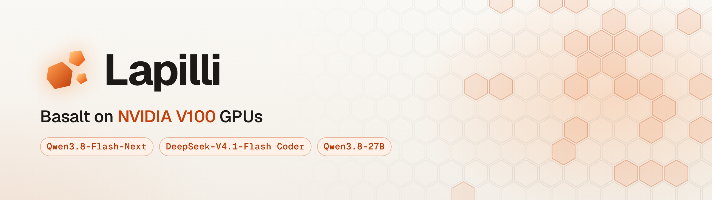
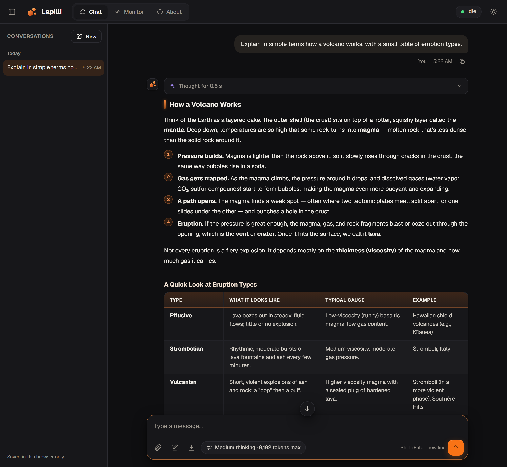
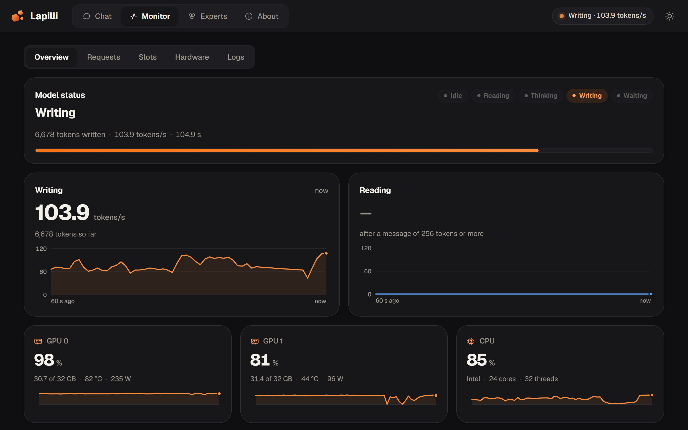
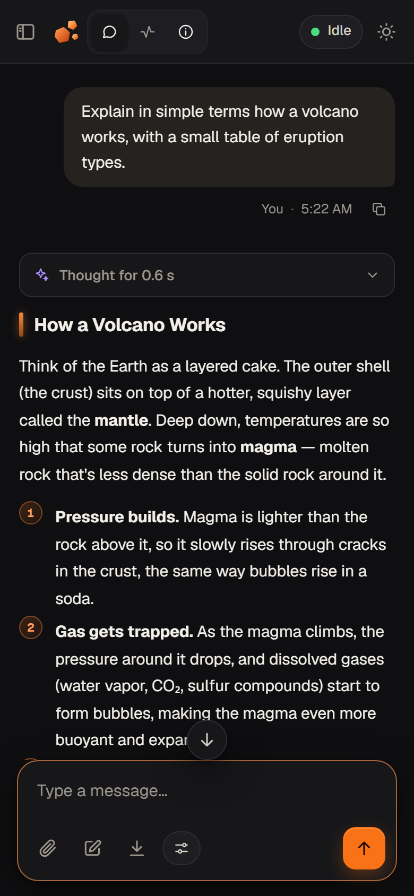
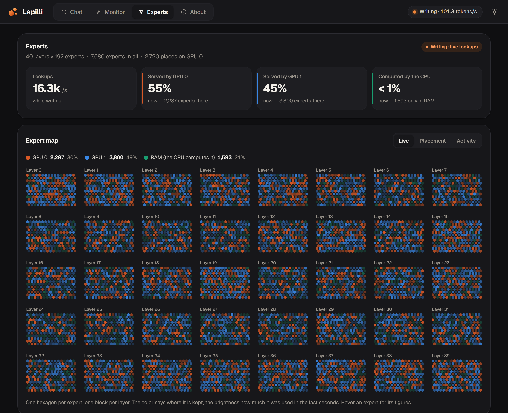

<p align="center">
  <picture>
    <source media="(prefers-color-scheme: dark)" srcset="docs/img/lapilli-banner-dark.png">
    
  </picture>
</p>

<p align="center">
  <a href="https://github.com/chris83-dev/lapilli-v100/releases"></a>
  
  
  
  <a href="LICENSE"></a>
</p>

<p align="center">
  <b>Your V100 isn't done yet.</b><br>
  A port of <a href="https://github.com/jesdga95/basalt">Basalt</a> to Volta (compute capability 7.0), with a chat page and a live monitor.
</p>

<p align="center">
  <a href="#the-three-models">Models</a> ·
  <a href="#recommended-models">Downloads</a> ·
  <a href="#whats-new-in-v05">What's new</a> ·
  <a href="#tested-by-the-community">Community</a> ·
  <a href="#quick-start-windows">Quick start</a> ·
  <a href="#build">Build</a> ·
  <a href="README.fr.md">Français</a>
</p>

Upstream Basalt targets Blackwell (sm_120) only. Lapilli adds sm_70 and keeps the Blackwell build as it was. One
`basalt.exe` runs all three of Basalt's models on V100 cards; the server keeps Basalt's OpenAI and Anthropic APIs and serves
the Lapilli chat page at `/` (Basalt's dashboard moves to `/dashboard`).

*Lapilli are the small fragments a volcano throws out: small pieces of basalt.*

<p align="center"></p>
<p align="center">&nbsp;&nbsp;</p>
<p align="center"></p>
<p align="center"><sub>The chat page and the same page on a phone, with the Qwen3.8-27B on one V100; the Monitor while an answer is written and
the Experts tab with its 7,680 experts, with the DeepSeek Coder on two. Screenshots of this build.</sub></p>

> Based on Basalt commit `6809edfa` (November 15, 2026), with a few later upstream pieces (the expert map's console, MIT).
> Provided as is, without support (see [Support](#support)).

## The three models

| | GPUs | Pack | Writing speed | Prompt reading | Quality against BF16 |
|---|---|---|---|---|---|
| **Qwen3.8-27B**<br><sub>dense, NVFP4</sub> | **1 × V100** | 21 GB, the official pack | **88** tokens/s with its drafter on a conversation, 186 on structured output | 697 tokens/s at 16K, 637 at 32K | KLD 0.02297, same top-1 93.37% |
| **DeepSeek-V4.1-Flash Coder**<br><sub>192 experts, IQ2_XXS</sub> | 2 × V100 | 192 GB, converted (see below) | **98** tokens/s on code, 64 on prose, with its DSpark drafter | | no BF16 reference for this pack |
| **Qwen3.8-Flash-Next**<br><sub>mixture of experts</sub> | 2 × V100 | 115 GB, `UD-Q4_K_XL` | **139** tokens/s on a long answer with reasoning, 91 on a short one | 1,172 tokens/s at 4K, 1,446 at 16K | KLD 0.04932, same top-1 92.75% |

Measured on one machine: 2 × V100-SXM2 32 GB (on PCIe 3.0 x16 and x4 links, peer-to-peer off: see below), Intel Core
i9-14900K, 96 GB of RAM, Windows 10, CUDA 12.6, NVIDIA driver 561.17, the packs on an NVMe SSD. Measured on November 23, 2026,
with the build from this repository. Speeds measured through the server are the median of three runs; `basalt-bench`'s
(the 27B) are its mean of three runs. Quality is Basalt's own gate
(`basalt-bench --quality 100`: 100 chunks through the decode path, against the BF16 reference).

## Recommended models

The packs every figure above was measured with, and where to download them. Each pack has its own license on its Hugging
Face page.

### Qwen3.8-27B, on one V100

A dense model of 27 billion parameters: 64 layers (48 Gated DeltaNet, 16 gated attention), thinking and tools, a context of
up to 262,144 tokens, and a DFlash 2 block drafter in the pack that writes several tokens at a time.

- **Pack**: `Qwen3.8-27B-QUASAR-NVFP4.basalt`, 21.1 GB: the official Basalt pack (NVFP4 weights, from QUASAR's checkpoint)
- **Download**: [jesdga/Qwen3.8-27B-Basalt](https://huggingface.co/jesdga/Qwen3.8-27B-Basalt) · [direct link](https://huggingface.co/jesdga/Qwen3.8-27B-Basalt/resolve/main/Qwen3.8-27B-QUASAR-NVFP4.basalt)
- **Needs**: one V100 32 GB

```bat
hf download jesdga/Qwen3.8-27B-Basalt Qwen3.8-27B-QUASAR-NVFP4.basalt --local-dir models
bin\basalt.exe serve models\Qwen3.8-27B-QUASAR-NVFP4.basalt --gpu 0 --kv int8 --max-context 262144 --port 8080
```

### DeepSeek-V4.1-Flash Coder, on two V100s

DeepSeek-V4.1-Flash is a mixture of experts: 40 layers of 384 experts, 6 chosen for each token plus a shared one.
ISTA-DASLab's GSQ-RCO Coder is a version for code that keeps 192 of the 384 experts of each layer, in IQ2_XXS; Unsloth's DSpark
drafter writes several tokens at a time. There is no ready-made Basalt pack for it: you build it from the GGUF files (about
184 GB to download, 192 GB once built).

- **Model**: [ISTA-DASLab/DeepSeek-V4.1-Flash-1017-GSQ-RCO-Coder-GGUF](https://huggingface.co/ISTA-DASLab/DeepSeek-V4.1-Flash-1017-GSQ-RCO-Coder-GGUF) (revision `54229d38`): the five parts of `IQ2_XXS/` (72.1 GB), the Engram table `DeepSeek-V4.1-Flash-Engram-IQ4_NL.gguf` (110.6 GB) and `mmproj-DeepSeek-V4.1-Flash-1017-BF16.gguf` (1.0 GB)
- **Drafter**: [unsloth/DeepSeek-V4.1-Flash-1017-GGUF](https://huggingface.co/unsloth/DeepSeek-V4.1-Flash-1017-GGUF) (revision `dfcee0ec`): `dspark-DeepSeek-V4.1-Flash-1017-Q8_0.gguf` (8.0 GB)
- **Needs**: two V100 32 GB, 96 GB of RAM with 20 GB kept free (its RAM tier is pinned), a fast NVMe SSD

1. Put the five `IQ2_XXS` parts, the `mmproj` file and the Engram table in one folder, the Engram table renamed as the sixth
   part: `DeepSeek-V4.1-Flash-1017-GSQ-RCO-Coder-IQ2_XXS-00006-of-00006.gguf`.
2. Convert, then add the drafter (the converter reads the GGUF files memory-mapped: about 10 minutes from an NVMe SSD), then
   start the server:

```bat
.venv\Scripts\python tools\convert\convert.py --gguf <folder>\DeepSeek-V4.1-Flash-1017-GSQ-RCO-Coder-IQ2_XXS-00001-of-00006.gguf --mmproj <folder>\mmproj-DeepSeek-V4.1-Flash-1017-BF16.gguf --out models\DeepSeek-V4.1-Flash-1017-GSQ-RCO-Coder-IQ2_XXS.basalt
.venv\Scripts\python tools\convert\convert.py --dspark dspark-DeepSeek-V4.1-Flash-1017-Q8_0.gguf --into models\DeepSeek-V4.1-Flash-1017-GSQ-RCO-Coder-IQ2_XXS.basalt --undo-dir models\dspark-undo
bin\basalt.exe serve models\DeepSeek-V4.1-Flash-1017-GSQ-RCO-Coder-IQ2_XXS.basalt --gpu 0,1 --kv fp16 --vram-reserve-mib 700 --ram-reserve-mib 20480 --max-context 32768 --vision off --port 8080
```

The finished pack is 192,059,655,012 bytes, in 14 sections. Its expert ranking for 192 experts, derived from the base model's
by `tools/profiles/derive_pruned_profile.py`, is in `data/profiles/`. A V100 has no FP8: the cache is fp16.

### Qwen3.8-Flash-Next, on two V100s

A mixture of experts: 48 layers (36 Gated DeltaNet, 12 QSA attention) of 512 experts, 10 chosen for each token, an MTP drafter
in the pack, and image input. The experts that do not fit in VRAM are read from RAM and from the SSD.

- **Pack**: `Qwen3.8-FN-UD-Q4_K_XL.basalt`, 115 GB (K-quants: the NVFP4 packs of this model need FP4 hardware)
- **Download**: [jesdga/Qwen3.8-Flash-Next-Basalt](https://huggingface.co/jesdga/Qwen3.8-Flash-Next-Basalt) · [direct link](https://huggingface.co/jesdga/Qwen3.8-Flash-Next-Basalt/resolve/main/Qwen3.8-FN-UD-Q4_K_XL.basalt)
- **Needs**: two V100 32 GB, 96 GB of RAM, a fast NVMe SSD
- **Smaller**: `Qwen3.8-FN-UD-IQ3_XXS.basalt` (87.6 GB, same page), run by a user on one V100 16 GB: see [the report](docs/community/v100-16gb-linux.md)

```bat
hf download jesdga/Qwen3.8-Flash-Next-Basalt Qwen3.8-FN-UD-Q4_K_XL.basalt --local-dir models
bin\basalt.exe serve models\Qwen3.8-FN-UD-Q4_K_XL.basalt --gpu 0,1 --kv int8 --mmap-experts --resident-experts --peer-exclusive --vram-reserve-mib 700 --ram-reserve-mib 16384 --max-context 262144 --vision dynamic --port 8080
```

## Measured details

<details>
<summary><b>Qwen3.8-27B on one V100</b></summary>

A V100 has neither FP4 nor FP8 tensor cores. At load, the pack's NVFP4 planes become ggml's NVFP4 blocks in place and the
FP8 head becomes Q8_0; the products run on the dp4a path and, for long prompts, on Volta's own tensor cores with the same
bits. The activations stay in 8 bits, where Blackwell rounds them to 4.

| | Lapilli, 1 × V100 | Basalt's figures on an RTX 5090 (int8 cache) |
|---|---|---|
| Perplexity (BF16: 6.7411) | 6.8304 | 6.826 |
| Mean KLD | 0.02297 | 0.0259 |
| Same top-1 token | 93.37% | 92.89% |

| Writing (`basalt-bench -t conv,struct,prose`, seed 7) | conversation | structured | prose |
|---|---|---|---|
| With the DFlash 2 drafter (the default) | 88 | 186 | 66 |
| Without a drafter (`--spec 0`) | 40 | 37 | 38 |

Prompt reading: 697 tokens/s at 16K tokens, 637 at 32K. Writing after a long prompt, without a drafter:
33.2 tokens/s after 32K, 30.2 after 64K (`basalt-bench --depth-decode`). Tokens/s, in tokens of the answer.

</details>

<details>
<summary><b>DeepSeek-V4.1-Flash Coder on two V100s</b></summary>

Writing, greedy, through the server (the median of three runs after a warm-up): 98 tokens/s on code (a complete
Python class, 512 tokens), 64 on prose (256 tokens), with the DSpark drafter. There is no BF16 reference for this
pack, so no quality gate.

This model keeps a faster V100 layout for its Q5_K products, on by default for it alone: with it a row's bits depend on
the width of its window, but its text already depends on where its experts live (on a card or in RAM), run to run.
`BASALT_MULTI_V70=0` turns it off: 92 tokens/s on code, 62 on prose.

</details>

<details>
<summary><b>Qwen3.8-Flash-Next on two V100s</b></summary>

| | Lapilli, 2 × V100 | Basalt's published figures for this pack (RTX 5090) |
|---|---|---|
| Perplexity | 3.3206 | 3.321 |
| Mean KLD | 0.04932 | 0.0496 |
| Same top-1 token | 92.75% | 92.63% |

| | v0.5 | v0.4, same machine and runs |
|---|---|---|
| Writing, short answer (256 tokens, temperature 0) | 91 tokens/s | 90 tokens/s |
| Writing, long answer with reasoning (1,500 tokens) | 139 tokens/s | 139 tokens/s |
| Prompt reading, ~4,200 / ~8,000 / ~16,000 tokens | 1,172 / 1,503 / 1,446 tokens/s | |

</details>

124 of Basalt's 139 GPU parity tests pass on a V100. The others test paths a V100 does not take: Blackwell-only kernels
(FP8, FP4, TMA), thread-block clusters (the engine uses its cluster-free fallback), more than 96 KB of shared memory per
block, and three DeepSeek fingerprints recorded on Blackwell, whose bits add in another order on Volta (their numerical
checks pass). For the 27B and the Flash-Next, every row of a product gives the same bits whatever the width of its
window, so a drafter changes the speed, never the answer.

## What's new in v0.5

- **One engine for three models.** `-DBASALT_MODELS=qwen4exp;deepseek41;qwen35`; the server picks the model from the pack.
  The Flash-Next computes exactly as in v0.4 (the same quality gate figures to the last digit).
- **Qwen3.8-27B on a single V100** (the official NVFP4 pack): every product on MMQ's dp4a path, a decode kernel for the
  drafter's windows (`dense_mmvq`, bit for bit the reference path at every window width), the steps around the products fused.
- **DeepSeek-V4.1-Flash Coder on two V100s**: the indexer kernels on sm_70, products laid out for Volta, the DSpark drafter.
- **Volta's own tensor cores**: the long-prompt products on `mma.m8n8k4` with the dp4a path's exact bits (+48% prompt reading
  at 16K, +65% at 32K on the 27B), the prompt attention and a one-pass decode attention on WMMA.
- **The Monitor in five sections** (Overview, Requests, Slots, Hardware, Logs) and an **Experts tab**: every expert drawn by
  where it lives (VRAM, the second card, RAM, the file) and how often it is read. From upstream Basalt's console (MIT).
- **The chat page**: the maximum length goes up to the model's context; a phone-sized Monitor.
- **`basalt-bench --depth-decode N`**: the writing speed after each long prompt.

The previous release, [v0.4.0-v100.1](https://github.com/chris83-dev/lapilli-v100/releases/tag/v0.4.0-v100.1) (the Flash-Next
only), stays available.

## Tested by the community

People tested Lapilli on their own machines and shared everything. Their figures, as they reported them:

| | Machine | What they ran | Their results |
|---|---|---|---|
| **[nebod99](docs/community/one-v100-pcie-linux.md)** | 1 × V100 PCIe 32 GB, Linux (CUDA 12.6.3 in Docker), i9-10940X, 96 GB | v0.4, Qwen3.8-Flash-Next `IQ3_S`, a 7,242-token prompt, thinking on | **100.9 tokens/s** at 128K context (Strata: 55.6), first token **8.7 s** (22.6); on 2,500+ questions, the same quality as Strata |
| **[ildargiv](docs/community/v100-16gb-linux.md)** | 1 × V100-SXM2 **16 GB**, Ubuntu 22.04, Ryzen 5 5600G, 96 GB | v0.4, Qwen3.8-Flash-Next `IQ3_XXS`, the first 16 GB card | **67.8 / 76.0 / 70.4 tokens/s** writing after 1K / 8K / 32K prompts; prompt reading 497 / 1,033 / 1,174 tokens/s; a stable 16 GB setup |
| **[Csavoldi](docs/community/inkling2-mini.md)** | 2 × V100 PCIe 32 GB, one in use | **Inkling 2 Mini** ported onto Lapilli: upstream Basalt v0.5.5 merged with the Volta paths | **69 tokens/s** writing (60.5 at 42K, 44.4 at 165K); prompt 850 tokens/s; 512K context; 5/5 top-1 against llama.cpp |

Thank you, nebod99, ildargiv and Csavoldi. Lapilli had only ever run on one machine; you took it to Linux, to a single card,
to a 16 GB V100 and to a new model, measured carefully and wrote down what others need to do the same. Every V100 owner
benefits from your work.

## Quick start (Windows)

1. Download `lapilli-v100-v0.5.0-v100.1-windows-x64.zip` from the [releases](https://github.com/chris83-dev/lapilli-v100/releases)
   and unzip it. It holds `bin\` (`basalt`, `basalt-bench`, `basalt-probe`, `basalt-vision`), the server, the chat page,
   `data\`, `docs\`, `requirements.txt` and the licences, built for the three models; like Basalt's archives, no CUDA
   libraries and no Python environment.
2. Install an NVIDIA driver that supports CUDA 12.6 (tested: 561.17), the CUDA 12 runtime libraries on the `PATH`
   (`cudart64_12.dll`, `cublas64_12.dll`, `cublasLt64_12.dll`: the CUDA Toolkit 12.6 to 12.9 installs them) and the Microsoft
   Visual C++ 2015-2022 Redistributable (x64).
3. Create the Python environment at the archive's top directory: `py -3 -m venv .venv` then
   `.venv\Scripts\pip install -r requirements.txt`.
4. Download a pack and start the server with its command (see [Recommended models](#recommended-models)), then open
   `http://127.0.0.1:8080/`.

## Requirements

- One or more NVIDIA V100 GPUs: one 32 GB card for the 27B, two for the DeepSeek Coder and for the Flash-Next as measured.
  Tested by users: one V100 PCIe 32 GB and one V100-SXM2 16 GB with the Flash-Next (see [Tested by the community](#tested-by-the-community)).
- Windows 10 or 11 x64, or Linux (run by users with CUDA 12.6.3 in Docker and on Ubuntu 22.04; the build steps below are for
  Windows).
- CUDA Toolkit 12.6 to 12.9 (CUDA 13 dropped Volta), the Visual Studio 2022 Build Tools (C++), CMake 3.24+, Python 3.10+.
- System RAM and a fast SSD for the experts that do not fit in VRAM. Tested with 96 GB of RAM.

## Build

From an *x64 Native Tools Command Prompt for VS 2022*:

```bat
git clone https://github.com/chris83-dev/lapilli-v100 lapilli && cd lapilli
cmake -S . -B build70 -G Ninja -DCMAKE_BUILD_TYPE=Release -DCMAKE_CUDA_ARCHITECTURES=70 "-DBASALT_MODELS=qwen4exp;deepseek41;qwen35" -DCMAKE_CUDA_RUNTIME_LIBRARY=Shared
cmake --build build70
py -3 -m venv .venv
.venv\Scripts\pip install -r requirements.txt
```

The executables land in `bin\`. A full build of the three models, tests included, took 48 minutes on a 24-core i9-14900K with 6 parallel jobs. `-DCMAKE_CUDA_RUNTIME_LIBRARY=Shared` avoids a duplicate `cudart` at link time
on Windows. `-DBUILD_TESTING=ON` adds the parity tests (`ctest --test-dir build70 -L gpu`). On Linux, users built it with the
same CMake options (see their reports).

## What changed from Basalt

- **Build**: compute capability 7.0 is accepted next to 12.0, with CUDA 12.6 or newer.
- **A compatibility layer** (`include/basalt/kernels/volta_compat.cuh`): every newer PTX instruction the engine uses
  (`cp.async`, `ldmatrix`, the `mma` shapes of Turing and Ampere, tf32 and bf16 conversions, `griddepcontrol`, clusters) gets
  a correct sm_70 equivalent, so every kernel compiles and runs right on a V100.
- **V100 paths for the hot kernels**: llama.cpp's dp4a path for the quantized prompt products, and their NVFP4 version on
  Volta's tensor cores with the same bits; int8 prompt attention on the V100 tensor cores (`mma.m8n8k4`, from Strata); the 27B's
  attention on WMMA; hyper-connection reads, the router, the decode experts and the GDN recurrence rewritten for Volta; the
  DeepSeek indexer without clusters; the expert exchange between two cards tuned for V100.
- **Peer-to-peer access is off by default on Volta**: on the test machine, direct copies between the two V100s returned wrong
  data. The copies go through the host instead. `BASALT_PEER_NO_P2P=0` turns peer access back on, at your own risk.
- **Server**: the exact resume of a follow-up turn; the expert map and the slots' figures on `/metrics` and `/slots`; a
  request's `fit_max_tokens: true` cuts its `max_tokens` to the room the context leaves.
- **The Lapilli chat page** at `/`; Basalt's dashboard at `/dashboard`.

The `BASALT_*` environment variables added by the port are the A/B switches used while measuring it; their defaults are the
best measured on V100, and they are not meant as settings. Three may help: `BASALT_MMQ_HMMA=0` and `BASALT_ATTN_PROMPT=i8`
put the prompt products and the prompt attention back on their v0.4 paths if a new path misbehaves on your card;
`BASALT_MULTI_V70=0` turns off the DeepSeek's faster Q5_K layout (and `auto` turns it on for the other models).

## Not tested

NVLink with peer access on; the DeepSeek Coder and the 27B on Linux; packs other than those above (and `IQ3_S`, `IQ3_XXS` of
the Flash-Next, run by users); Blackwell builds of this fork.

## Support

This fork is shared as is, in the hope that it helps other V100 owners. There is no promise of support or updates. Issues
may be read, but may not get an answer.

## Credits and license

MIT, like Basalt ([LICENSE](LICENSE)). Lapilli stands on the work of others:

- [Basalt](https://github.com/jesdga95/basalt) by Jesús Gulfo (MIT): the engine, its three models and the expert map's console.
- [Strata](https://github.com/Niko1221/Strata) by Niko1221 and the Strata contributors (MIT): Basalt's origin, and the V100
  prompt-attention kernel used here.
- [llama.cpp / ggml](https://github.com/ggml-org/llama.cpp) (MIT): the dp4a prompt products.
- The models' authors, and the packs: [ISTA-DASLab](https://huggingface.co/ISTA-DASLab) (the 192-expert Coder),
  [Unsloth](https://huggingface.co/unsloth) (the DSpark drafter in GGUF), jesdga (the Basalt packs).
- [marked](https://github.com/markedjs/marked) (MIT): the chat page's text formatting. Geist font (SIL Open Font License).

Every notice is in [THIRD_PARTY_LICENSES](THIRD_PARTY_LICENSES). Basalt's own README, with its models and documentation, is at
[github.com/jesdga95/basalt](https://github.com/jesdga95/basalt); this repository's `docs/` is Basalt's documentation, written
for Blackwell.

French: [README.fr.md](README.fr.md).
